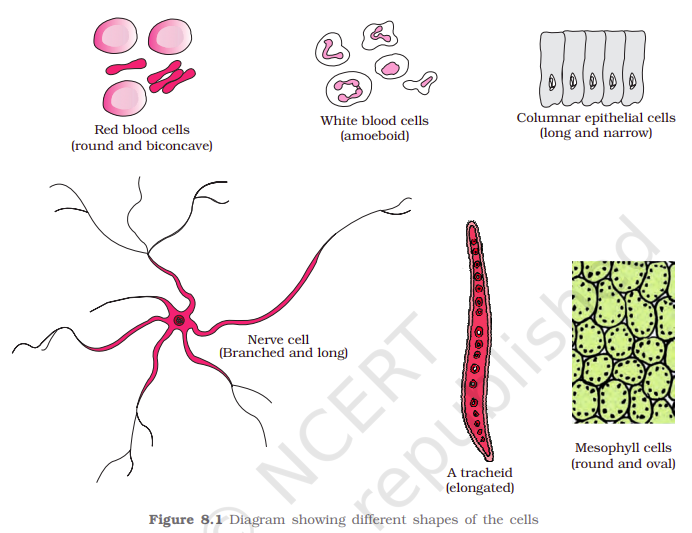

You have earlier observed cells in an onion peel and/or human cheek cells under the microscope. Let us recollect their structure. The onion cell which is a typical plant cell, has a distinct cell wall as its outer boundary and just within it is the cell membrane. The cells of the human cheek have an outer membrane as the delimiting structure of the cell. Inside each cell is a dense membrane bound structure called nucleus. This nucleus contains the chromosomes which in turn contain the genetic material, DNA. Cells that have <b>membrane bound nuclei are called eukaryotic </b>whereas cells that <b>lack a membrane bound nucleus are prokaryotic</b>. In both prokaryotic and eukaryotic cells, a semi-fluid matrix called cytoplasm occupies the volume of the cell. The <b>cytoplasm </b>is the main arena of cellular activities in both the plant and animal cells. Various chemical reactions occur in it to keep the cell in the ‘living state’.

Besides the nucleus, the eukaryotic cells have other membrane bound distinct structures called organelles like the endoplasmic reticulum (ER), the golgi complex, lysosomes, mitochondria, microbodies and vacuoles. The prokaryotic cells lack such membrane bound organelles (these specific organelles are completely absent).

[<b>Ribosomes </b>](/p/3ddea6c903f180bf917cc11b09d11073?pvs=25)are non-membrane bound organelles found in all cells – both eukaryotic as well as prokaryotic. Within the cell, ribosomes are found not only in the cytoplasm but also within the two organelles – chloroplasts (in plants) and mitochondria and on rough ER (Endoplasmic Reticulum)

Most of the Animal cells contain another non-membrane bound organelle called <b>centrosome </b>which helps in cell division.

<callout icon="💡" color="gray_bg">
<b>Who has centrosome (Centrosome distribution)?</b>

<b>Prokaryotic Cells:</b> They completely <b>lack centrosomes</b> (and all other membrane-bound or complex organelles). Prokaryotes divide through a much simpler process called binary fission.

<b>Plant Cells:</b> Most plants—specifically <b>higher plants</b> like conifers and flowering plants—<b>do not have centrosomes</b>. They are able to divide and form spindle fibres during cell division using alternative cellular structures. Only lower plants (like mosses and ferns) with motile sperm cells contain centrosomes or centrioles.

<b>Eukaryotic Cells:</b> While the centrosome is a eukaryotic organelle, it is <b>primarily found in animal cells</b>. Many other eukaryotes, such as fungi and higher plants, do not possess them.

<i>Some lower plant cell ((like mosses and ferns) with motile sperm cells contain centrosomes or centrioles. And most of the Eukaryotic cells (primarily animal cell, except fungi) has centrosome.</i>
</callout>

Cells differ greatly in size, shape and activities (Figure 8.1). For example, Mycoplasmas, the smallest cells, are only 0.3 mm in length while bacteria could be 3 to 5 µm. The largest isolated single cell is the egg of an Ostrich (উটপাখি). Among multicellular organisms, human red blood cells are about 7.0 µm in diameter. Nerve cells are some of the longest cells. Cells also vary greatly in their shape. They may be disc-like, polygonal, columnar, cuboid, thread like, or even irregular. The shape of the cell may vary with the function they perform.

- [3.1.1.1 Prokaryotic Cell](3-1-1-overview-of-cell/3-1-1-1-prokaryotic-cell.md)
- [3.1.1.2 Eukaryotic Cell](3-1-1-overview-of-cell/3-1-1-2-eukaryotic-cell.md)
