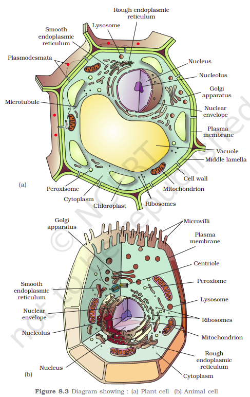

The eukaryotes include all the protists, plants, animals and fungi. In eukaryotic cells there is an extensive compartmentalisation of cytoplasm through the presence of membrane bound organelles. Eukaryotic cells possess an organized nucleus with a nuclear envelope. In addition, eukaryotic cells have a variety of complex locomotory and cytoskeletal structures. Their genetic material is organized into chromosomes.

All eukaryotic cells are not identical. Plant and animal cells are different as the former possess cell walls, plastids and a large central vacuole which are absent in animal cells. On the other hand, animal cells have centrioles which are absent in almost all plant cells (Figure 8.3). Let us now look at individual cell organelles to understand their structure and functions.

- [3.1.1.2.1 Cell Membrane](3-1-1-2-eukaryotic-cell/3-1-1-2-1-cell-membrane.md)
- [3.1.1.2.2 Cell Wall](3-1-1-2-eukaryotic-cell/3-1-1-2-2-cell-wall.md)
- [3.1.1.2.3 Endomembrane System](3-1-1-2-eukaryotic-cell/3-1-1-2-3-endomembrane-system.md)
- [3.1.1.2.4 Mitochondria](3-1-1-2-eukaryotic-cell/3-1-1-2-4-mitochondria.md)
- [3.1.1.2.5 Plastids](3-1-1-2-eukaryotic-cell/3-1-1-2-5-plastids.md)
- [3.1.1.2.6 Ribosomes](3-1-1-2-eukaryotic-cell/3-1-1-2-6-ribosomes.md)
- [3.1.1.2.7 Cytoskeleton](3-1-1-2-eukaryotic-cell/3-1-1-2-7-cytoskeleton.md)
- [3.1.1.2.8 Cilia and Flagella](3-1-1-2-eukaryotic-cell/3-1-1-2-8-cilia-and-flagella.md)
- [3.1.1.2.9 Centrosome and Centrioles](3-1-1-2-eukaryotic-cell/3-1-1-2-9-centrosome-and-centrioles.md)
- [3.1.1.2.10 Nucleus](3-1-1-2-eukaryotic-cell/3-1-1-2-10-nucleus.md)
- [3.1.1.2.11 Microbodies](3-1-1-2-eukaryotic-cell/3-1-1-2-11-microbodies.md)
