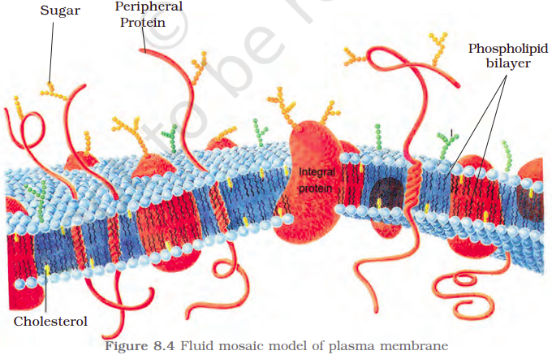

The detailed structure of the membrane was studied only after the advent of the electron microscope in the 1950s. Meanwhile, chemical studies on the cell membrane, especially in human red blood cells (RBCs), enabled the scientists to deduce the possible structure of plasma membrane.

These studies showed that the cell membrane is mainly composed of lipids and proteins. The major lipids are phospholipids that are arranged in a bilayer. Also, the lipids are arranged within the membrane with the polar head towards the outer sides and the hydrophobic tails towards the inner part. This ensures that the nonpolar tail of saturated hydrocarbons is protected from the aqueous environment (Figure 8.4). In addition to phospholipids, membrane also contains cholesterol.

Later, biochemical investigation clearly revealed that the cell membranes also possess protein and carbohydrate. The ratio of protein and lipid varies considerably in different cell types. In human beings, the membrane of the erythrocyte has approximately 52 per cent protein and 40 per cent lipids.

Depending on the ease of extraction, membrane proteins can be classified as integral and peripheral. Peripheral proteins lie on the surface of membrane while the integral proteins are partially or totally buried in the membrane.

An improved model of the structure of cell membrane was proposed by Singer and Nicolson (1972) widely accepted as <b>fluid mosaic model</b> (Figure 8.4). According to this, the quasi-fluid nature of lipid enables lateral movement of proteins within the overall bilayer. This ability to move within the membrane is measured as its fluidity.

The fluid nature of the membrane is also important from the point of view of functions like cell growth, formation of intercellular junctions, secretion, endocytosis, cell division etc.

One of the most important functions of the plasma membrane is the transport of the molecules across it. The membrane is selectively permeable to some molecules present on either side of it. Many molecules can move briefly across the membrane without any requirement of energy and this is called the <b>passive transport</b>. Neutral solutes may move across the membrane by the process of simple diffusion along the concentration gradient, i.e., from higher concentration to the lower. Water may also move across this membrane from higher to lower concentration. Movement of water by diffusion is called osmosis. As the polar molecules cannot pass through the nonpolar lipid bilayer, they require a carrier protein of the membrane to facilitate their transport across the membrane. A few ions or molecules are transported across the membrane against their concentration gradient, i.e., from lower to the higher concentration. Such a transport is an energy dependent process, in which ATP is utilized and is called active transport, e.g., $Na^+$/$K^+$ Pump.
