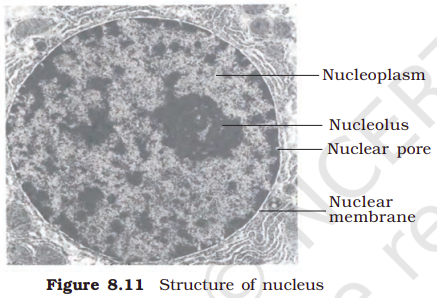
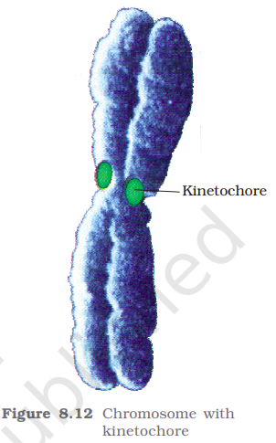
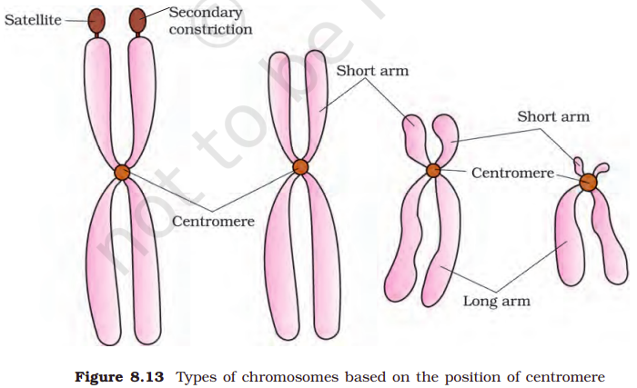

Nucleus as a cell organelle was first described by Robert Brown as early as 1831. Later the material of the nucleus stained by the basic dyes was given the name chromatin by Flemming.

The interphase nucleus (nucleus of a cell when it is not dividing) has highly extended and elaborate nucleoprotein fibres called chromatin, nuclear matrix and one or more spherical bodies called nucleoli (sing.: nucleolus) (Figure 8.11). Electron microscopy has revealed that the nuclear envelope, which consists of two parallel membranes with a space between (10 to 50 nm) called the perinuclear space, forms a barrier between the materials present inside the nucleus and that of the cytoplasm. The outer membrane usually remains continuous with the endoplasmic reticulum and also bears ribosomes on it. At a number of places the nuclear envelope is interrupted by minute pores, which are formed by the fusion of its two membranes. These nuclear pores are the passages through which movement of RNA and protein molecules takes place in both directions between the nucleus and the cytoplasm. Normally, there is only one nucleus per cell, variations in the number of nuclei are also frequently observed. Can you recollect names of organisms that have more than one nucleus per cell? Some mature cells even lack nucleus, e.g., erythrocytes of many mammals and sieve tube cells of vascular plants. Would you consider these cells as ‘living’?

The nuclear matrix or the nucleoplasm contains nucleolus and chromatin. The nucleoli are spherical structures present in the nucleoplasm. The content of nucleolus is continuous with the rest of the nucleoplasm as it is not a membrane bound structure. It is a site for active ribosomal RNA synthesis. Larger and more numerous nucleoli are present in cells actively carrying out protein synthesis.

You may recall that the interphase nucleus has a loose and indistinct network of nucleoprotein fibres called chromatin. But during different stages of cell division, cells show structured chromosomes in place of the nucleus. Chromatin contains DNA and some basic proteins called histones, some non-histone proteins and also RNA. A single human cell has approximately two metre long thread of DNA distributed among its forty six (twenty three pairs) chromosomes. You will study the details of DNA packaging in the form of a chromosome in class XII.

Every chromosome (visible only in dividing cells) essentially has a primary constriction or the centromere on the sides of which disc shaped structures called kinetochores are present (Figure 8.12). Centromere holds two chromatids of a chromosome. Based on the position of the centromere, the chromosomes can be classified into four types (Figure 8.13). The metacentric chromosome has middle centromere forming two equal arms of the chromosome. The sub-metacentric chromosome has centromere slightly away from the middle of the chromosome resulting into one shorter arm and one longer arm. In case of acrocentric chromosome the centromere is situated close to its end forming one extremely short and one very long arm, whereas the telocentric chromosome has a terminal centromere.

Sometimes a few chromosomes have non-staining secondary constrictions at a constant location. This gives the appearance of a small fragment called the satellite.

<columns>
<column ratio="37.5">

</column>
<column ratio="62.5">

</column>
</columns>

