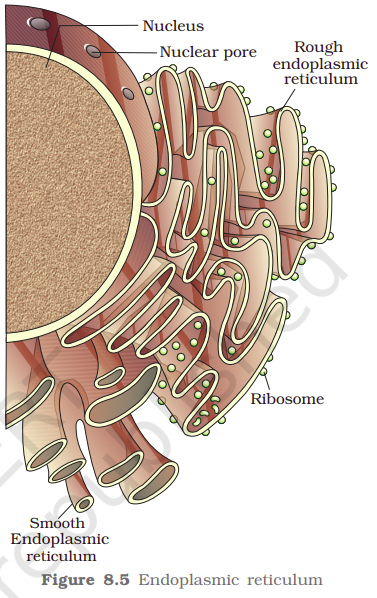
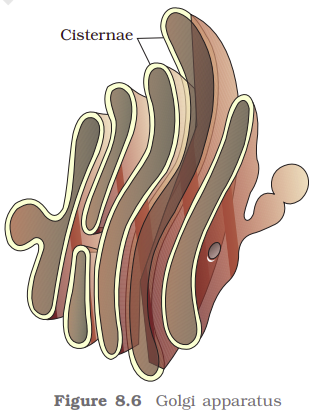

While each of the membranous organelles is distinct in terms of its structure and function, many of these are considered together as an endomembrane system because their functions are coordinated. The endomembrane system include endoplasmic reticulum (ER), golgi complex, lysosomes and vacuoles. Since the functions of the mitochondria, chloroplast and peroxisomes are not coordinated with the above components, these are not considered as part of the endomembrane system.

<b>The Endoplasmic Reticulum (ER): </b>Electron microscopic studies of eukaryotic cells reveal the presence of a network or reticulum of tiny tubular structures scattered in the cytoplasm that is called the endoplasmic reticulum (ER) (Figure 8.5). Hence, ER divides the intracellular space into two distinct compartments, i.e., luminal (inside ER) and extra luminal (cytoplasm) compartments.

The ER often shows ribosomes attached to their outer surface. The endoplasmic reticulum bearing ribosomes on their surface is called rough endoplasmic reticulum (RER). In the absence of ribosomes they appear smooth and are called smooth endoplasmic reticulum (SER).

RER is frequently observed in the cells actively involved in protein synthesis and secretion. They are extensive and continuous with the outer membrane of the nucleus.

The smooth endoplasmic reticulum is the major site for synthesis of lipid. In animal cells lipid-like steroidal hormones are synthesized in SER.

<b>Golgi apparatus: </b>Camillo Golgi (1898) first observed densely stained reticular structures near the nucleus. These were later named Golgi bodies after him. They consist of many flat, disc-shaped sacs or cisternae of 0.5µm to 1.0µm diameter (Figure 8.6). These are stacked parallel to each other. Varied number of cisternae are present in a Golgi complex. The Golgi cisternae are concentrically arranged near the nucleus with distinct convex cis or the forming face and concave trans or the maturing face. The cis and the trans faces of the organelle are entirely different, but interconnected.

The golgi apparatus principally performs the function of packaging materials, to be delivered either to the intra-cellular targets or secreted outside the cell. Materials to be packaged in the form of vesicles from the ER fuse with the cis face of the golgi apparatus and move towards the maturing face. This explains, why the golgi apparatus remains in close association with the endoplasmic reticulum. A number of proteins synthesized by ribosomes on the endoplasmic reticulum are modified in the cisternae of the golgi apparatus before they are released from its trans face. Golgi apparatus is the important site of formation of glycoproteins and glycolipids.

<b>Lysosomes: </b>These are membrane bound vesicular structures formed by the process of packaging in the golgi apparatus. The isolated lysosomal vesicles have been found to be very rich in almost all types of hydrolytic enzymes (hydrolases – lipases, proteases, carbohydrases) optimally active at the acidic pH. These enzymes are capable of digesting carbohydrates, proteins, lipids and nucleic acids.

<b>Vacuoles: </b>The vacuole is the membrane-bound space found in the cytoplasm. It contains water, sap, excretory product and other materials not useful for the cell. The vacuole is bound by a single membrane called tonoplast. In plant cells the vacuoles can occupy up to 90 per cent of the volume of the cell.

In plants, the tonoplast facilitates the transport of a number of ions and other materials against concentration gradients into the vacuole, hence their concentration is significantly higher in the vacuole than in the cytoplasm.

In Amoeba, the contractile vacuole is important for osmoregulation and excretion. In many cells, as in protists, food vacuoles are formed by engulfing the food particles.
