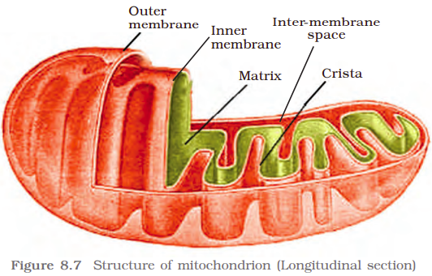
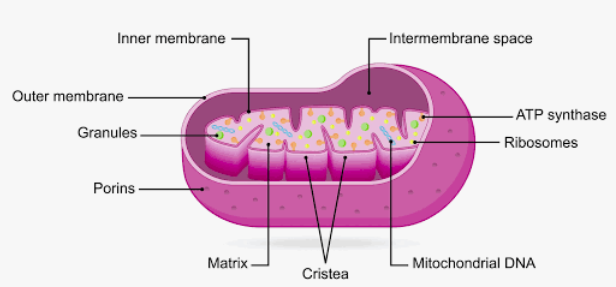

Mitochondria (sing.: mitochondrion), unless specifically stained, are not easily visible under the microscope. The number of mitochondria per cell is variable depending on the physiological activity of the cells. In terms of shape and size also, considerable degree of variability is observed. Typically it is sausage-shaped or cylindrical having a diameter of 0.2-1.0µm (average 0.5µm) and length 1.0-4.1µm. Each mitochondrion is a double membrane-bound structure with the outer membrane and the inner membrane dividing its lumen distinctly into two aqueous compartments, i.e., the outer compartment and the inner compartment. The inner compartment is filled with a dense homogeneous substance called the matrix. The outer membrane forms the continuous limiting boundary of the organelle. The inner membrane forms a number of infoldings called the cristae (sing.: crista) towards the matrix (Figure 8.7). The cristae increase the surface area. The two membranes have their own specific enzymes associated with the mitochondrial function. Mitochondria are the sites of aerobic respiration. They produce cellular energy in the form of ATP, hence they are called ‘power houses’ of the cell. The matrix also possesses single circular DNA molecule, a few RNA molecules, ribosomes(70S) and the components required for the synthesis of proteins. The mitochondria divide by fission.

## [AI Notes:](/p/3e8ea6c903f1801fb9cfe031c40a0838?pvs=25)

<b>🏛️ Structure of a Mitochondrion</b>

A mitochondrion is uniquely built with <b>two membranes</b> that create distinct compartments optimized for energy production:

- <b>Outer Membrane:</b> A smooth protective barrier containing special protein channels called <b>porins</b> that allow small molecules to pass through easily.
- <b>Inner Membrane:</b> A highly selective barrier folded into many finger-like wrinkles called <b>cristae</b>. These folds vastly increase the surface area available for energy-producing chemical reactions.
- <b>Intermembrane Space:</b> The narrow channel between the inner and outer membranes where a concentration gradient of protons is built up.
- <b>Matrix:</b> The fluid-filled center space enclosed by the inner membrane. It contains a specialized cocktail of metabolic enzymes, ribosomes, and the mitochondrion's own unique DNA.

<b>⚡ How Mitochondria Produce Energy</b>

Mitochondria produce energy through a multi-step metabolic pathway known as <b>cellular respiration</b>. The ultimate goal of this process is to manufacture <b>ATP (adenosine triphosphate)</b>, the universal energy currency of life.

1. <b>The Fuel Prep (Glycolysis & Link Reaction):</b> Cells first break down carbohydrates (like glucose) in the main body of the cell (cytoplasm) into smaller units called pyruvate. This pyruvate is transported into the mitochondrial matrix and converted into a molecule called <b>Acetyl-CoA</b>.
2. <b>The Processing Center (The Krebs / Citric Acid Cycle):</b> Inside the matrix, Acetyl-CoA is systematically broken down. This cycle strips away high-energy electrons and loads them onto carrier molecules called <b>NADH</b> and <b>FADH₂</b>. It also releases carbon dioxide ($CO_2$) as a waste product.
3. <b>The Power Grid (The Electron Transport Chain):</b> The electron carriers (NADH) and ($FADH_2$) deliver their high-energy electrons to a chain of protein complexes embedded across the inner membrane foldings (cristae). As electrons flow down this chain like water over a dam, they release energy. The proteins use this energy to actively pump hydrogen ions (protons) out of the matrix and into the tight intermembrane space.
4. <b>The Turbine (ATP Synthase):</b> Because so many protons have been crammed into the intermembrane space, they want to rush back into the matrix. They can only cross back through a specialized, spinning molecular turbine protein called <b>ATP synthase</b>. As protons flow through it, the turbine spins, mechanically snapping a phosphate molecule onto ADP to synthesize mass amounts of <b>ATP</b>. <b>Oxygen</b> sits at the end of the electron transport chain to catch the spent electrons and protons, forming water ($H_2O$) as a clean byproduct.

---

<b>🧬 How Mitochondria Divide (Mitochondrial Fission)</b>

Unlike most other structures in a cell, mitochondria cannot be created from scratch by your cellular DNA. Instead, they grow and reproduce by <b>splitting in half</b>, a process called <b>mitochondrial fission</b> that closely resembles how bacteria divide.

- <b>Replication:</b> When a cell needs more energy, the individual mitochondrion copies its own circular loop of DNA.
- <b>Constriction:</b> Protein rings (principally a protein called <b>Drp1</b>) wrap around the center of the elongated mitochondrion like an invisible rubber band.
- <b>Separation:</b> The protein rings tighten, pinching both the inner and outer membranes until the single organelle snaps into two fully functioning, independent mitochondria.

Conversely, when mitochondria are damaged or stressed, they can merge back together to share resources via a process called <b>mitochondrial fusion</b>.

---

<b>🦕 More Fascinating Details: The Bacterial Ancestry</b>

Mitochondria are unique because they carry their own independent loop of DNA (<b>mtDNA</b>) and their own ribosomes, completely separate from the DNA stored in your cell's main nucleus.

Scientists explain this using the <b>Endosymbiotic Theory</b>. Billions of years ago, the ancestor of all complex modern cells was a simple, single-celled organism. It swallowed a free-living, oxygen-breathing bacterium. Instead of digesting it, the host cell kept it alive because the bacterium provided an immense survival advantage by generating massive amounts of energy. Over evolutionary timelines, this captured bacterium completely integrated with the host, transforming into the modern mitochondrion we rely on today.

Would you like to explore <b>how lifestyle habits</b> (like exercise or fasting) trigger mitochondria to multiply, or would you prefer a closer look at how <b>mitochondrial diseases</b> are uniquely inherited from mothers?

<b>🤝 Why does a mitochondrion have its own ribosomes?</b>

Because of their evolutionary history as ancient bacteria, mitochondria contain a tiny, independent set of blueprints (mitochondrial DNA).

To build the custom, highly specialized protein machinery required to generate ATP, the mitochondrion uses its <b>own internal ribosomes</b> to manufacture those proteins right on the spot.
