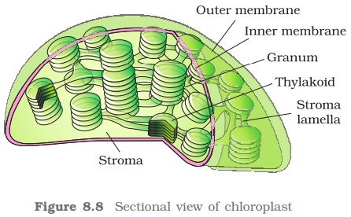

Plastids are found in all plant cells and in euglenoides. These are easily observed under the microscope as they are large. They bear some specific pigments, thus imparting specific colours to the plants. Based on the type of pigments plastids can be classified into <b>chloroplasts</b>, <b>chromoplasts </b>and <b>leucoplasts</b>. 

The chloroplasts contain chlorophyll and carotenoid pigments which are responsible for trapping light energy essential for photosynthesis. In the chromoplasts, fat soluble carotenoid pigments like carotene, xanthophylls and others are present. This gives the part of the plant a yellow, orange or red colour. The leucoplasts are the colourless plastids of varied shapes and sizes with stored nutrients: Amyloplasts store carbohydrates (starch), e.g., potato; elaioplasts store oils and fats whereas the aleuroplasts store proteins. 

Majority of the chloroplasts of the green plants are found in the mesophyll cells of the leaves. These are lens-shaped, oval, spherical, discoid or even ribbon-like organelles having variable length (5-10µm) and width (2-4µm). Their number varies from 1 per cell of the Chlamydomonas, a green alga to 20-40 per cell in the mesophyll.

Like mitochondria, the chloroplasts are also double membrane bound. Of the two, the inner chloroplast membrane is relatively less permeable. The space limited by the inner membrane of the chloroplast is called the stroma. A number of organized flattened membranous sacs called the thylakoids, are present in the stroma (Figure 8.8). Thylakoids are arranged in stacks like the piles of coins called grana (singular: granum) or the intergranal thylakoids. In addition, there are flat membranous tubules called the stroma lamellae connecting the thylakoids of the different grana. The membrane of the thylakoids enclose a space called a lumen. The stroma of the chloroplast contains enzymes required for the synthesis of carbohydrates and proteins. It also contains small, doublestranded circular DNA molecules and ribosomes. Chlorophyll pigments are present in the thylakoids. The ribosomes of the chloroplasts are smaller (70S) than the cytoplasmic ribosomes (80S).

