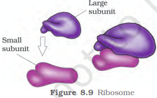

Ribosomes are the granular structures first observed under the electron microscope as dense particles by George Palade (1953). They are composed of ribonucleic acid (RNA) and proteins and are not surrounded by any membrane.

The eukaryotic ribosomes are 80S while the prokaryotic ribosomes are 70S. Each ribosome has two subunits, larger and smaller subunits (Fig 8.9). The two subunits of 80S ribosomes are 60S and 40S while that of 70S ribosomes are 50S and 30S. Here ‘S’ (Svedberg’s Unit) stands for the sedimentation coefficient; it is indirectly a measure of density and size. Both 70S and 80S ribosomes are composed of two subunits.

