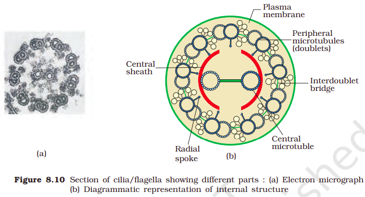

Cilia (sing.: cilium) and flagella (sing.: flagellum) are hair-like outgrowths of the cell membrane. Cilia are small structures which work like oars, causing the movement of either the cell or the surrounding fluid. Flagella are comparatively longer and responsible for cell movement. The prokaryotic bacteria also possess flagella but these are structurally different from that of the eukaryotic flagella. 

The electron microscopic study of a cilium or the flagellum show that they are covered with plasma membrane. Their core called the axoneme, possesses a number of microtubules running parallel to the long axis. The axoneme usually has nine doublets of radially arranged peripheral microtubules, and a pair of centrally located microtubules. Such an arrangement of axonemal microtubules is referred to as the 9+2 array (Figure 8.10). The central tubules are connected by bridges and is also enclosed by a central sheath, which is connected to one of the tubules of each peripheral doublets by a radial spoke. Thus, there are nine radial spokes. The peripheral doublets are also interconnected by linkers. Both the cilium and flagellum emerge from centriole-like structure called the basal bodies.

