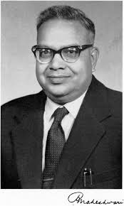
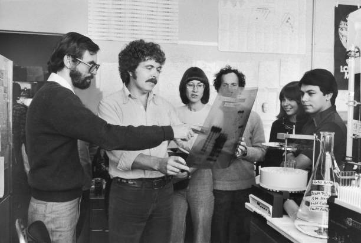

# Biology

## Scientists and Discoveries

| Year | Scientist | Event |
| --- | --- | --- |
|  | **Antonie Von Leeuwenhoek** | first saw and described a live cell. |
| 1831 | **Robert Brown** | Nucleus as a cell organelle was first described. |
| 1838 | **Matthias Schleiden** German Botanist | examined a large number of plants and observed that all plants are composed of different kinds of cells which form the tissues of the plant. |
| 1839 | **Theodore Schwann** German Zoologist | studied different types of animal cells and reported that cells had a thin outer layer which is today known as the ***'plasma membrane'***. |
|  | **Schwann** | proposed the hypothesis that the bodies of animals and plants are composed of cells and products of cells. |
|  | **Schleiden and Schwann** | together formulated the cell theory. This theory however, did not explain as to how new cells were formed. |
| 1855 | **Rudolf Virchow** | first explained that cells divided and new cells are formed from pre-existing cells (*Omnis cellula-e cellula* → All cells arise from pre-existing cells). This is refer as "Cell Division", before this theory many people believed in "spontaneous generation"—the idea that cells could just magically pop out of thin air, mud, or non-living matter if conditions were right. |
| 1884 | **Hans Christian Gram** (Danish scientist) | invented a quick 4-step staining process to make transparent bacteria visible under a microscope: ***Gram positive, Gram negative.*** |
| 1898 | **Camillo Golgi** | first observed densely stained reticular structures near the nucleus. |
| 1953 | **George Palade** | Ribosomes are the granular structures first observed under the electron microscope as dense particles. |
| 1972 | **Stanley Cohen and Herbert Boyer** | created the very first man-made **recombinant DNA (rDNA)** molecule. |

## Scientist Profiles

Katherine Esau (1898 – 1997)

<figure class="portrait">KE</figure>

<b>KATHERINE ESAU</b> was born in Ukraine in 1898.

She studied agriculture in Russia and Germany and received her doctorate in 1931 in United States.

She reported in her early publications that the <b>curly top virus</b> spreads through a plant via the <b>food conducting or phloem tissue</b>.

Dr Esau’s <i>Plant Anatomy</i> published in 1954 took a dynamic, developmental approach designed to enhance one’s understanding of plant structure and an enormous impact worldwide, literally bringing about a revival of the discipline.

<i>The Anatomy of Seed Plants</i> by Katherine Esau was published in 1960. It was referred to as Webster’s of plant biology – it is encyclopediac.

In 1957 she was elected to the National Academy of Sciences, becoming the sixth woman to receive that honour.

In addition to this prestigious award, she received the National Medal of Science from President George Bush in 1989.

When Katherine Esau died in the year 1997, Peter Raven, director of Anatomy and Morphology, Missouri Botanical Garden, remembered that she ‘absolutely dominated’ the field of plant biology even at the age of 99.

Panchanan Maheshwari (1904 – 1966)

<figure class="portrait"><figcaption>Photo: Anneliesmariefrank17, CC BY-SA 4.0</figcaption></figure>

Born in November 1904 in Jaipur (Rajasthan), Panchanan Maheshwari rose to become one of the most distinguished botanists not only in India but across the world. He moved to Allahabad for higher education, where he obtained his D.Sc. During his college days, he was inspired by Dr W. Dudgeon, an American missionary teacher, to develop an interest in botany—especially morphology. His teacher once said that it would give him great satisfaction if a student surpassed him. These words encouraged Panchanan to consider what he could do in return for his teacher.

He worked on embryological aspects and popularised the use of embryological characters in taxonomy. He established the Department of Botany at the University of Delhi as an important centre for research in embryology and tissue culture. He also emphasised the need to initiate work on the artificial culture of immature embryos. Today, tissue culture has become a landmark in science. His work on test tube fertilisation and intra-ovarian pollination won worldwide acclaim.

He was honoured with fellowship of the Royal Society of London (FRS), the Indian National Science Academy, and several other institutions of excellence. He encouraged general education and made a significant contribution to school education by leading the development of the very first Biology textbooks for Higher Secondary Schools, published by NCERT in 1964.

Ramdeo Misra (1908 – 1998)

<figure class="portrait">RM</figure>

Ramdeo Misra is revered as the Father of Ecology in India. Born on 26 August 1908, Ramdeo Misra obtained Ph.D in Ecology (1937) under Prof. W. H. Pearsall, FRS, from Leeds University in UK. He established teaching and research in ecology at the Department of Botany of the Banaras Hindu University, Varanasi. His research laid the foundations for understanding of tropical communities and their succession, environmental responses of plant populations and productivity and nutrient cycling in tropical forest and grassland ecosystems. Misra formulated the first postgraduate course in ecology in India. Over 50 scholars obtained Ph. D degree under his supervision and moved on to other universities and research institutes to initiate ecology teaching and research across the country. He was honoured with the Fellowships of the Indian National Science Academy and World Academy of Arts and Science, and the prestigious Sanjay Gandhi Award in Environment and Ecology. Due to his efforts, the Government of India established the National Committee for Environmental Planning and Coordination (1972) which, in later years, paved the way for the establishment of the Ministry of Environment and Forests (1984).

Herbert Boyer (1936)

<figure class="portrait"><figcaption>Photo: Crystal Rictor 12, CC0</figcaption></figure>

Herbert Boyer was born in 1936 and brought up in a corner of western Pennsylvania where railroads and mines were the destiny of most young men. He completed graduate work at the University of Pittsburgh, in 1963, followed by three years of post-graduate studies at Yale. In 1966, Boyer took over assistant professorship at the University of California at San Francisco. By 1969, he performed studies on a couple of restriction enzymes of the E. coli bacterium with especially useful properties. Boyer observed that these enzymes have the capability of cutting DNA strands in a particular fashion, which left what has became known as ‘sticky ends’ on the strands. These clipped ends made pasting together pieces of DNA a precise exercise. This discovery, in turn, led to a rich and rewarding conversation in Hawaii with a Stanford scientist named Stanley Cohen. Cohen had been studying small ringlets of DNA called plasmids and which float about freely in the cytoplasm of certain bacterial cells and replicate independently from the coding strand of DNA. Cohen had developed a method of removing these plasmids from the cell and then reinserting them in other cells. Combining this process with that of DNA splicing enabled Boyer and Cohen to recombine segments of DNA in desired configurations and insert the DNA in bacterial cells, which could then act as manufacturing plants for specific proteins. This breakthrough was the basis upon which the discipline of biotechnology was founded.

## Chapters

| Chapter |
| --- |
| [1. DIVERSITY IN THE LIVING WORLD](01-diversity-in-the-living-world/index.md) |
| [2. STRUCTURAL ORGANISATION IN PLANTS AND ANIMALS](02-structural-organisation-in-plants-and-animals/index.md) |
| [3. CELL: STRUCTURE AND FUNCTIONS](03-cell-structure-and-functions/index.md) |
| [4. PLANT PHYSIOLOGY](04-plant-physiology/index.md) |
| [5. HUMAN PHYSIOLOGY](05-human-physiology/index.md) |
| [6. REPRODUCTION](06-reproduction/index.md) |
| [7. GENETICS AND EVOLUTION](07-genetics-and-evolution/index.md) |
| [8. BIOLOGY IN HUMAN WELFARE](08-biology-in-human-welfare/index.md) |
| [9. BIOTECHNOLOGY](09-biotechnology/index.md) |
| [10. ECOLOGY](10-ecology/index.md) |
