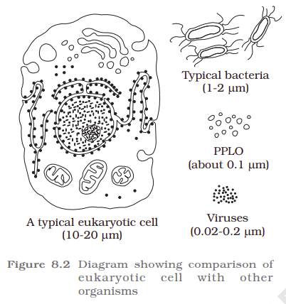

<table header-row="true" header-column="true">
<colgroup>
<col width="239.66666666666666" />
<col width="293.6625061035156" />
</colgroup>
<tr>
<td>
Word
</td>
<td>
Bengali
</td>
</tr>
<tr>
<td>
confers
</td>
<td>
প্রদান করে
</td>
</tr>
<tr>
<td>
phenotypic 
</td>
<td>
বাহ্যিক বা দৃশ্যমান
</td>
</tr>
<tr>
<td>
In the form of inclusions
</td>
<td>
কোষের ভেতরে সঞ্চিত নির্জীব উপাদান
</td>
</tr>
</table>

The prokaryotic cells are represented by bacteria, blue-green algae, mycoplasma and PPLO (Pleuro Pneumonia Like Organisms). They are generally smaller and multiply more rapidly than the eukaryotic cells (Figure 8.2). They may vary greatly in shape and size. The four basic shapes of bacteria are <b>bacillus (rod like)</b>, <b>coccus (spherical)</b>, <b>vibrio (comma shaped)</b> and <b>spirillum (spiral)</b>.

The organization of the prokaryotic cell is fundamentally similar even though prokaryotes exhibit a wide variety of shapes and functions. All prokaryotes have a cell wall surrounding the cell membrane except in [<b>mycoplasma</b>](/p/3ddea6c903f18005a152f312133cd3e1?pvs=25). The semifluid matrix filling the cell is the cytoplasm. There is no well-defined nucleus. The genetic material is basically naked, not enveloped by a nuclear membrane. In addition to the [<b>genomic DNA</b>](/p/3ddea6c903f180c292e5fe753f763a4b?pvs=25)(the single chromosome/circular DNA), many bacteria have small circular DNA outside the genomic DNA. These smaller DNA are called <b>plasmids</b>. The plasmid DNA confers certain unique phenotypic characters to such bacteria. One such character is resistance to antibiotics. In higher classes you will learn that this plasmid DNA is used to monitor bacterial transformation with foreign DNA. Nuclear membrane is found in eukaryotes. No organelles, like the ones in eukaryotes, are found in prokaryotic cells except for ribosomes. Prokaryotes have something unique in the form of inclusions. A specialized differentiated form of cell membrane called mesosome is the characteristic of prokaryotes. They are essentially infoldings of cell membrane.

<callout icon="💡" color="gray_bg">
You will never find a prokaryotic cell making up an animal. Animals are entirely <b>eukaryotic organisms</b>, meaning every single cell that forms an animal's muscles, nerves, and organs contains a proper nucleus and membrane-bound organelles.

prokaryotes are strictly divided into two domains:

<b>Bacteria:</b> The most common prokaryotes (like <i><u>E. coli</u></i> or <i><u>Lactobacillus</u></i>).

<b>Archaea:</b> Ancient, single-celled prokaryotes that often live in extreme environments, like hot springs or deep-sea vents.

 <b>The Catch: Prokaryotes live inside animals (</b><i>microbiome</i><b> </b><i>ecosystem</i><b>)</b>

While animals are not <i>made</i> of prokaryotic cells, <b>animals cannot live without them</b>. Millions of prokaryotic bacteria live inside the guts, on the skin, and in the mouths of animals. For example, the bacteria in a cow's stomach break down grass, and the bacteria in your own gut help you digest food and produce vitamins. 

<i>This ecosystem of prokaryotes living inside a eukaryotic host is known as the </i><i><b>microbiome</b></i><i>.</i>

<table header-row="true">
<colgroup>
<col />
<col width="247.60000610351562" />
<col width="361" />
</colgroup>
<tr>
<td>
<b>Feature</b>
</td>
<td>
<b>Animal Cells (Eukaryotes)</b>
</td>
<td>
<b>Bacteria (Prokaryotes)</b>
</td>
</tr>
<tr>
<td>
<b>Nucleus</b>
</td>
<td>
<b>Present</b> (DNA is safely locked inside)
</td>
<td>
<b>Absent</b> (DNA floats freely in a clump (গুচ্ছ বা ঝোপ))
</td>
</tr>
<tr>
<td>
<b>Organelles</b>
</td>
<td>
Has membrane-bound structures (Mitochondria, Golgi)
</td>
<td>
No membrane-bound structures
</td>
</tr>
<tr>
<td>
<b>Organism Type</b>
</td>
<td>
Always multicellular complex life
</td>
<td>
Always single-celled (unicellular)
</td>
</tr>
<tr>
<td>
<b>Size</b>
</td>
<td>
Much larger and more complex
</td>
<td>
Microscopic and simple
</td>
</tr>
</table>
</callout>

- [3.1.1.1.1 Cell Envelope and its Modifications](3-1-1-1-prokaryotic-cell/3-1-1-1-1-cell-envelope-and-its-modifications.md)
- [3.1.1.1.2 Ribosomes and Inclusion Bodies](3-1-1-1-prokaryotic-cell/3-1-1-1-2-ribosomes-and-inclusion-bodies.md)

