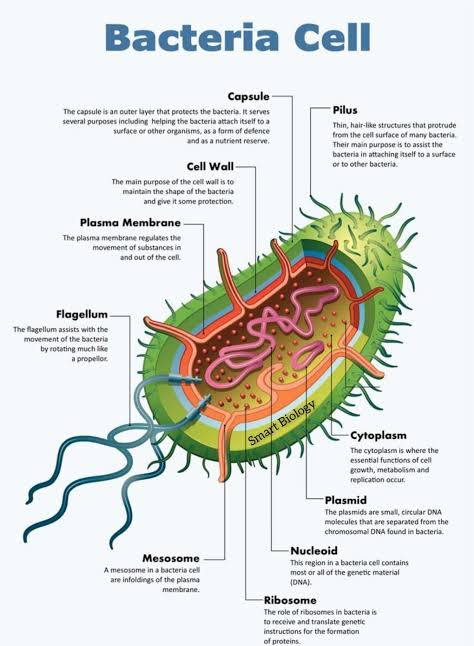

<table header-row="true" header-column="true">
<colgroup>
<col width="239.66666666666666" />
<col width="239.66666666666666" />
</colgroup>
<tr>
<td>
Word
</td>
<td>
Bengali
</td>
</tr>
<tr>
<td>
vesicles (ভেসিকল)
</td>
<td>
গোলাকার থলি বিশেষ
</td>
</tr>
<tr>
<td>
tubules (টিউবিউল )
</td>
<td>
নলাকার অংশ
</td>
</tr>
<tr>
<td>
lamellae (ল্যামেলি)
</td>
<td>
চ্যাপ্টা পর্দা বা স্তরবিশিষ্ট অংশ
</td>
</tr>
</table>

Most prokaryotic cells, particularly the bacterial cells, have a chemically complex cell envelope. The cell envelope consists of a tightly bound three layered structure i.e., the outermost <b>glycocalyx </b>followed by the <b>cell wall</b> and then the <b>plasma membrane</b>. Although each layer of the envelope performs distinct function, they act together as a single protective unit. Bacteria can be classified into two groups on the basis of the differences in the cell envelopes and the manner in which they respond to the staining procedure (রঞ্জন প্রক্রিয়া) developed by [Gram viz.](/p/3ddea6c903f180aa90d4de8c36c6ed74?pvs=25), those that take up the gram stain are Gram positive and the others that do not are called Gram negative bacteria.

- <b>Glycocalyx </b>differs in composition and thickness among different bacteria. It could be a loose sheath called the <b>slime layer</b> in some, while in others it may be thick and tough, called the <b>capsule</b>.
- The<b> cell wall</b> determines the shape of the cell and provides a strong structural support to prevent the bacterium from bursting or collapsing.
- The <b>plasma membrane </b>is [selectively permeable in nature and interacts with the outside world](/p/3ddea6c903f1807c947ced762858ca96?pvs=25). This membrane is similar structurally to that of the eukaryotes.

<callout icon="💡" color="gray_bg">
| <b>Feature</b> | <b>1. Glycocalyx</b> | <b>2. Cell Wall</b> | <b>3. Plasma Membrane</b> |
| --- | --- | --- | --- |
| <b>Position</b> | Outermost layer | Middle layer | Innermost layer |
| <b>Composition</b> | Polysaccharides, glycoproteins, or glycolipids. | Peptidoglycan (in bacteria); Cellulose or chitin (in plants/fungi). | Phospholipid bilayer embedded with proteins. |
| <b>Texture</b> | Sticky, gelatinous, or loose. | Rigid, tough, and structural. | Fluid, flexible, and dynamic. |
| <b>Main Role</b> | Adhesion, protection from immune systems, moisture retention. | Maintains shape and prevents the cell from bursting. | Selective transport of nutrients and wastes. |
</callout>

<callout icon="💡" color="gray_bg">
<b>1. </b><b>Glycocalyx (The Coating) </b>The glycocalyx is the outermost, sticky coating secreted by the cell. It generally comes in two different forms depending on the species: • <b>Capsule:</b> A highly organized, thick, and gummy layer that is tightly attached to the cell wall. It acts like a shield, helping pathogenic bacteria hide from a host’s immune system. • <b>Slime Layer:</b> A loose, unorganized shield that can easily wash off. Its main job is to keep the cell moist and help it stick to smooth surfaces (like teeth or medical equipment) to form biofilms.

<b>2. </b><b>Cell Wall (The Armor) </b>The cell wall sits directly beneath the glycocalyx. It is a rigid, structural matrix that functions as the cell’s skeleton. • <b>Prevents Lysis:</b> It stops the cell from swelling and bursting (osmotic lysis) when water flows inside. • <b>Chemical Identity:</b> In bacteria, its thickness determines whether they are Gram-positive (thick peptidoglycan layer) or Gram-negative (thin layer with an extra outer lipid membrane).

<b>3. </b><b>Plasma Membrane (The Gatekeeper) </b>The plasma membrane is the innermost boundary enclosing the cytoplasm. Unlike the tough cell wall, this layer is a dynamic, fluid mosaic. • <b>Selective Permeability:</b> It acts as a strict border control. It decides exactly what enters (like food and ions) and exits (like waste products) the cell. • <b>Metabolic Hub:</b> In prokaryotes, it houses vital proteins responsible for producing cellular energy (ATP) since they lack internal mitochondria.
</callout>

A special membranous structure is the [<b>mesosome</b>](/p/3dfea6c903f180959bd8d54ab23838a3?pvs=25)<b> </b>which is formed by the extensions of plasma membrane into the cell. These extensions are in the form of vesicles, tubules and lamellae. They help in cell wall formation, DNA replication and distribution to daughter cells. They also help in respiration, secretion processes, to increase the surface area of the plasma membrane and enzymatic content. 

In some prokaryotes like cyanobacteria, there are other membranous extensions into the cytoplasm called [chromatophores ](/p/3dfea6c903f180edbe09e18b043697e7?pvs=25)which contain pigments.

Bacterial cells may be motile or non-motile. If motile, they have thin filamentous extensions from their cell wall called [<b>flagella</b>](/p/3dfea6c903f18039af9edd4c4b632ec0?pvs=25). Bacteria show a range in the number and arrangement of flagella. Bacterial flagellum is composed of three parts – filament, hook and basal body. The filament is the longest portion and extends from the cell surface to the outside.

Besides flagella, [<b>Pili </b>](/p/3dfea6c903f18039af9edd4c4b632ec0?pvs=25)and [<b>Fimbriae </b>](/p/3dfea6c903f18039af9edd4c4b632ec0?pvs=25)are also surface structures of the bacteria but do not play a role in motility. The pili are elongated tubular structures made of a special protein. The fimbriae are small bristle like fibres sprouting out of the cell. In some bacteria, they are known to help attach the bacteria to rocks in streams and also to the host tissues.

